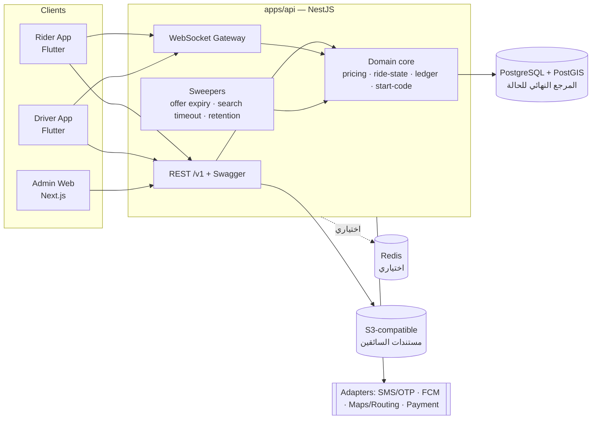

# المعمارية — Mishwar Yemen (مشوار اليمن)

> الحالة: تصميم المرحلة A. ما نُفّذ فعليًا وما اختُبر مذكور في `README.md` (جدول الحالة).

## 1. الصورة العامة

## 2. مبادئ ثابتة

1. **قاعدة البيانات هي المرجع الوحيد لحالة الرحلة.** الإشعارات وأحداث WebSocket وسيلة إبلاغ فقط؛ التطبيق عند إعادة الفتح أو الاتصال يطلب الحالة من الخادم (`GET /v1/rides/active`).
2. **الخادم وحده يسعّر.** التطبيق يرسل نقطتين فقط؛ الخادم يحسب السعر ويحفظ لقطة كاملة (`price_breakdown`) مع إصدار القاعدة على الرحلة، ولا تُعاد حسابها عند تغيير التعرفة.
3. **الإسناد ذرّي في PostgreSQL** (تحديث مشروط + فهارس فريدة جزئية + محفزات حماية) — انظر `database-design.md` §3.
4. **كل عملية قابلة للتكرار تحمل `Idempotency-Key`** (إنشاء الطلب، قبول العرض، العمليات المالية).
5. **كل خدمة خارجية خلف Adapter** (رسائل OTP، الإشعارات، الخرائط/التوجيه، الدفع الإلكتروني). لا مفاتيح في المستودع، ولا تعمل أي خدمة غير مهيأة بصمت: تفشل بوضوح أو تستخدم محوّلًا للتطوير يرفض الإقلاع في الإنتاج.
6. **نواة النطاق نقية** (`apps/api/src/domain`): بلا قاعدة بيانات ولا Nest، قابلة للاختبار فورًا، وتستدعيها الوحدات. لا يتكرر منطق الأعمال في التطبيقات.

## 3. وحدات الخادم (NestJS) وحدود المسؤولية

| الطبقة | الوحدات |
|---|---|
| الهوية والوصول | Auth، Users، Customers، Drivers، Vehicles، DriverVerification |
| الجغرافيا والتسعير | ServiceAreas، Pricing |
| دورة الرحلة | RideRequests، Dispatch، Trips، DriverLocations |
| المال | Payments، DriverWallet (دفتر الأستاذ والتسويات) |
| التفاعل | Ratings، Notifications، Support |
| التشغيل | Admin، AuditLogs، Health |

قاعدة التبعية: الوحدات تعتمد على `domain/` وعلى طبقة الوصول للبيانات، ولا تستدعي إحداها مستودع الأخرى مباشرة (تمر عبر الخدمة المعلنة). `Trips` وحدها تغيّر `rides.status`، و`DriverWallet` وحدها تكتب في `driver_ledger_entries`.

## 4. التسعير

ثلاثة أنماط في محرك واحد (`domain/pricing.ts`):

- **DISTANCE_TIME**: أساس + مسافة + زمن، حد أدنى، رسوم إضافية، خصم، تقريب لخطوة قابلة للتهيئة.
- **FIXED_ROUTE**: أجرة ثابتة لزوج مناطق (`fixed_routes`). إذا طابق الطلبُ مسارًا ثابتًا في القاعدة الفعّالة يُستخدم هذا النمط لذلك الطلب؛ قاعدة من نمط FIXED_ROUTE بلا تطابق لا تُصدر عرض سعر.
- **MANUAL**: لا يُسعَّر تلقائيًا؛ يتطلب موظفًا مخولًا يحدد المبلغ ويُسجَّل اسمه في اللقطة وفي سجل التدقيق.

القواعد مُصدَرة (`version`) وتصبح غير قابلة للتعديل بعد النشر (محفز في `0002`). **كل الأرقام في بيانات البذر وهمية** وتحددها الإدارة بعد دراسة السوق. سياسة تغيير الأجرة بعد بدء الرحلة: لا تغيير تلقائي؛ التعديل عبر موظف مخول فقط، مع سبب وتدقيق، ويُسجَّل في `final_total` دون المساس بـ `quoted_total`.

## 5. المطابقة (Dispatch)

1. تحقق من الطلب والمنطقة (`ST_Covers(service_areas.boundary, pickup)`).
2. مرشحون: `is_online` + `APPROVED` + لا رحلة نشطة + موقع أحدث من `location_max_age_seconds`.
3. بحث جغرافي بـ `ST_DWithin` ضمن `search_radius_m` باستخدام الفهرس الجزئي.
4. ترتيب بالمسافة المستقيمة **كتقدير فقط**؛ تُوسَم الأرقام في الواجهة «تقديرية» ما لم يتوفر مزود توجيه معتمد.
5. إنشاء `ride_offers` لدفعة صغيرة (`offer_batch_size`) بمهلة `offer_ttl_seconds`.
6. قبول السائق → معاملة الإسناد الذرّي.
7. رفض أو انتهاء مهلة → الدفعة التالية؛ عند `search_timeout_seconds` تصبح الرحلة `NO_DRIVER_FOUND`.

انتهاء العروض والبحث تعالجه مهمة دورية داخل الخادم تقرأ `expires_at` من قاعدة البيانات (لا مؤقتات في الذاكرة)، فلا يضيع شيء عند إعادة تشغيل الخادم ولا يلزم BullMQ في الإصدار الأول (ADR-0003).

## 6. الزمن الحقيقي وضعف الاتصال

- WebSocket لإبلاغ التغيّر؛ كل حدث يحمل `ride_id` و`ride_version` المتزايد، فيتجاهل العميل المتأخر والمكرر.
- بعد أي إعادة اتصال: `GET /v1/rides/active` ثم الاشتراك من جديد.
- موقع السائق يُعرض مع عمره؛ بعد تجاوز العتبة يظهر «آخر موقع معروف منذ …» لا «مباشر».
- العميل يعيد المحاولة بتراجع تدريجي بنفس `Idempotency-Key`؛ لا يُنفَّذ قبول أو دفع محليًا دون تأكيد الخادم.
- تخزين محلي: التوكنات في Secure Storage فقط؛ الكاش للبيانات غير الحساسة (أنواع المركبات، الأماكن المحفوظة).

## 7. خارج نطاق الإصدار الأول (موثّق عمدًا)

الرحلات المجدولة، مشاركة الرحلة، الدفع الإلكتروني (واجهة Adapter فقط)، كتالوج الخصومات والكوبونات (المحرك يقبل خصمًا لكن لا جدول له بعد)، إعادة إسناد رحلة لسائق آخر (الحل: إلغاء وطلب جديد)، خدمة طوارئ متصلة (نوفّر البلاغ وبيانات الدعم فقط).
