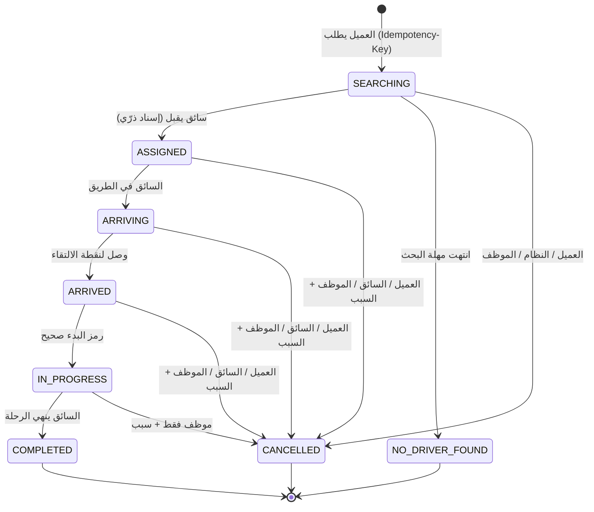
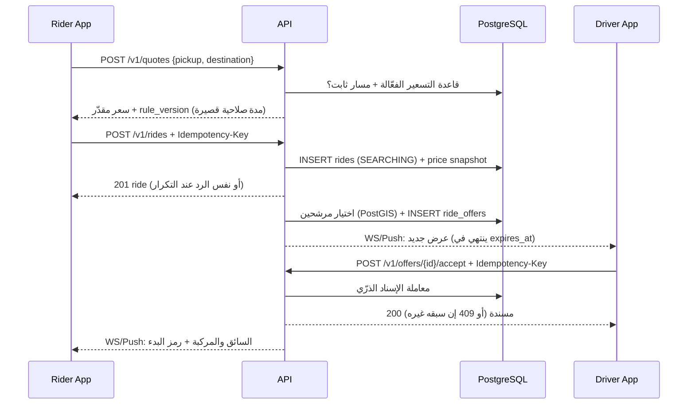

# تدفقات المستخدم

## 1. دورة حياة الرحلة

هذه الحالات مطبقة في `domain/ride-state.ts` (مختبرة) ومكررة كمحفز في `0002`. كل إلغاء يحفظ الفاعل (`cancelled_by_role`) والسبب والتوقيت.

## 2. طلب رحلة وقبولها

## 3. استعادة الحالة بعد انقطاع

1. التطبيق يفتح → `GET /v1/rides/active` (يعيد الرحلة الحالية للعميل أو السائق أو لا شيء).
2. يعرض الشاشة المطابقة لـ `status` ويعرض عمر آخر موقع للسائق.
3. يعيد فتح WebSocket ويستقبل الأحداث ذات `ride_version` الأحدث فقط.
4. أي طلب كتابة معلّق يُعاد بنفس `Idempotency-Key`؛ الرد المخزَّن يُعاد دون تكرار الأثر.
5. إن اختلفت حالة الهاتف عن الخادم، **الخادم يغلب** ويُعرض للمستخدم التغيير (مثلًا «أُلغيت الرحلة»).

## 4. تفعيل السائق

تسجيل ← رفع المستندات المطلوبة (من `document_types`) ← `PENDING` ← مراجعة موظف مخوّل ← `APPROVED`/`REJECTED` (مع سبب). السائق `PENDING` أو `REJECTED` أو `SUSPENDED` لا يستطيع الاتصال بالمنصة (قيد قاعدة + محفز).

## 5. الإغلاق المالي لرحلة نقدية

عند `COMPLETED`: `payment_records` (`CASH`, `COLLECTED_BY_DRIVER`) + قيدان في دفتر السائق: `EARNING +صافي` و`CASH_COLLECTED −الإجمالي`، فيظهر على السائق للمنصة مبلغ العمولة. التسوية بطلب `driver_payouts` يراجعه موظف مالي مختلف عن الطالب، ثم قيد تسوية. التفاصيل: `domain/ledger.ts`.
